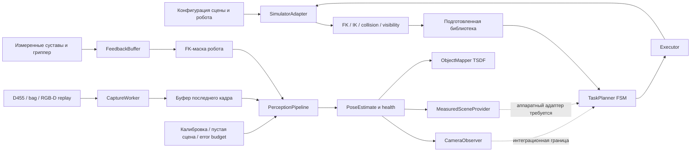

# Архитектура и поток данных

## Два связанных контура

Геометрический контур `TaskPlanner` управляет симуляцией захвата и осмотра.
Модуль `perception/` получает RGB-D и строит измерения для будущего аппаратного
адаптера. Они имеют совместимые точки подключения, но старый FSM пока не
переведён целиком на измеренные состояния камеры. Наличие `CameraObserver`
само по себе не удаляет обращения FSM к simulator truth.

Облако, ROS и обучаемые политики в рабочем пути этого snapshot не используются.
Захват и оценка идут в отдельных потоках. Чтение observer не ожидает USB,
реконструкцию или сетевой запрос. Данные хранятся в latest-only буфере, чтобы
перегрузка приводила к пропуску кадров, а не накоплению старых изображений.

## Карта исходников

| Файл | Ответственность |
|---|---|
| `core.py` | SE(3), конфигурация, SceneState, RobotInterface, coverage |
| `simulation.py` | сцена SO-101, индексы по именам, физика A/B/C, RGB-D |
| `geometry.py` | FK/Jacobian/IK, столкновения, геометрия захватов и видимости |
| `planning.py` | достижимые ракурсы, выбор/порядок, траектории, укладка и перехват |
| `library.py` | версионированная подготовка и повторная проверка планов |
| `control.py` | FSM, исполнение, стабилизация, торможение, отчёт эпизода |
| `grasp.py` | CameraObserver и независимое доказательство пробного подъёма |
| `perception/types.py` | immutable FramePacket, Calibration, PoseEstimate, Status |
| `perception/realsense.py` | D455 SDK, проверка профиля, единицы и timestamps |
| `perception/calibration.py` | pinhole rays и camera-to-base PnP |
| `perception/localizer.py` | компоненты глубины, плоскости и поза известного куба |
| `perception/pipeline.py` | tracking, симметрии, свежесть и выдача observer |
| `perception/scene.py`, `robot_mask.py` | reference пустой сцены и маска по суставам |
| `perception/mapping.py` | object-centric TSDF и keyframes |
| `perception/uncertainty.py` | случайные/систематические/временные границы ошибки |
| `perception/sensor_noise.py`, `feedback_noise.py` | офлайн-модели камеры, энкодеров, IMU |
| `perception/noise_fit.py` | статистики по записям и независимым эталонным плоскостям |
| `perception/runtime.py`, `sync.py` | потоки, ограниченные буферы и часы |
| `perception/snapshot.py`, `recording.py` | измеренный SceneState и sensor-only replay |

Все пути в таблице относятся к `src/active_scan/`.

## Системы координат

`T_A_B` переводит координаты точки из B в A. B — база робота, C — optical
frame глубины, O — объект, G — гриппер. В optical frame X направлен вправо,
Y вниз, Z вперёд. MuJoCo camera convention преобразуется явно.

Для объекта из depth получаем `T_B_O`; известная калибровка — `T_B_C`.
Регистрация объекта относительно камеры: `T_C_O = inverse(T_B_C) @ T_B_O`.
Для TSDF это world-to-camera extrinsic при выборе объекта как map world.
Преобразование удержания `T_G_O = inverse(T_B_G) @ T_B_O` должно строиться из
согласованных по времени поз, а не из нынешних суставов и старого изображения.

`MeasuredSceneProvider` требует близости timestamps камеры и переданной
обратной связи. Его snapshot относится ко времени экспозиции. Компенсация
задержки до текущего момента не создаётся автоматически.

## Локализация неподвижной камерой

Камера не оценивает собственную траекторию как мобильный SLAM. Её положение
фиксировано калибровкой, рабочая сцена задаётся reference, а объект движется.
Путь измерения: native depth → ROI/стол/маска → компоненты → ортогональные
плоскости → робастная подгонка известного куба 60 мм → temporal checks.

У немаркированного куба 24 эквивалентных вращения. Непрерывный tracking выбирает
ближайшую ветвь; после потери идентичность материальных граней не гарантируется.
Новая grasp/identity epoch не объединяется молча с прежней картой.

Низкая surface residual означает хорошее совпадение измеренных точек с моделью.
Она не доказывает точность camera-to-base: ошибка абсолютной позы может быть
сантиметровой при миллиметровой residual. Поэтому error budget хранится отдельно.

## Где проходит граница симуляции

- A: кинематика, не физический захват.
- B: динамика с явной идеальной weld-связью; успешный цикл условен на удержание.
- C: свободный куб и контакты; текущий контрольный тест не подтвердил подъём.
- Synthetic/MuJoCo RGB-D campaign: точная поза доступна только evaluator и
  генератору мира. В estimator не передаются pose truth или segmentation IDs.
- Hardware source: SDK-драйвер реализован, но реальная D455 в сеансе не найдена.
  Camera-to-base, материал, ошибки суставов и timestamps стенда не измерены.

Текущая готовность находится в [READINESS.json](../results/perception_sensor_model/READINESS.json).
